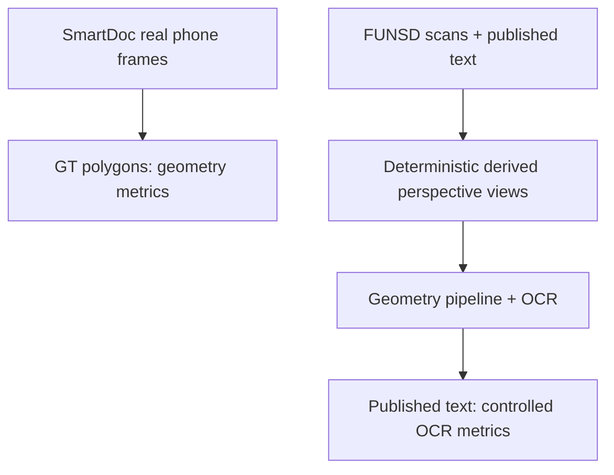

# Datasets

[SmartDoc](https://github.com/jchazalon/smartdoc15-ch1-dataset) (Burie et al., ICDAR 2015) is CC BY 4.0. Its named CSV columns encode TL,BL,BR,TR; the adapter converts them to TL,TR,BR,BL. Model suffixes 001?003/004/005 define dev/val/test before four quantile frames are selected per background. Native-image polygon IoU differs from the official document-frame score. There are no supported Challenge 1 transcription metrics here.

[FUNSD](https://guillaumejaume.github.io/FUNSD/) (Jaume, Ekenel and Thiran, 2019) is for noncommercial research/education. Users must personally accept its [terms](https://guillaumejaume.github.io/FUNSD/work/) and be at least 18. Official train/test is preserved; seeded training subdivision is 119/30. Published entity boxes assist primary OCR evaluation, so this measures recognition conditional on known text regions. Annotations can contain noise. Derived views are controlled transformations of scans, not camera photographs. Images and transformed images must not be committed or redistributed.
