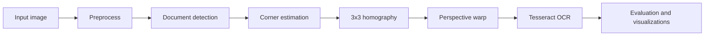

# Pipeline

EXIF orientation defines raw coordinates. Resize stores exact x/y scales. Detection uses Gaussian blur, Canny and external contours (all-contour fallback only if no candidates). Candidate score combines area (0.45), boundary support (0.45), convexity (0.10), and a border penalty (0.35). Each term is bounded to [0,1]. No right-angle constraint is imposed on perspective views.

Corners use cyclic convex ordering with an upright top-edge rule, then robust edge-corridor line fitting with gradient filtering. Rejected refinements retain the baseline and a diagnostic. Raw coordinates are recovered before the full-resolution warp. Four correspondences determine eight homography degrees of freedom; four points provide no redundancy for outlier rejection.

OCR settings are fixed across all five branches. The oracle branch is separate. Source algorithms: [OpenCV contours](https://docs.opencv.org/4.x/d3/dc0/group__imgproc__shape.html), [geometric transforms](https://docs.opencv.org/4.x/da/d54/group__imgproc__transform.html), [Tesseract](https://tesseract-ocr.github.io/tessdoc/).

If no valid quad is found, the fixed fallback Canny grid is 25/75, then 10/40. These settings were selected on validation before freezing. Baseline polygon approximation time is included in detection time. Refined line fitting is timed separately. OCR uses at most four CPU workers with one OpenMP thread per Tesseract subprocess; exact duplicate ROI pixels reuse the same recognition result.

Per-region OCR runtime refers to the measured recognition invocation. Exact duplicate pixel crops can reuse that invocation, including its audit metadata; summing those rows does not measure total experiment wall time. Run start/finish timestamps measure wall duration.
