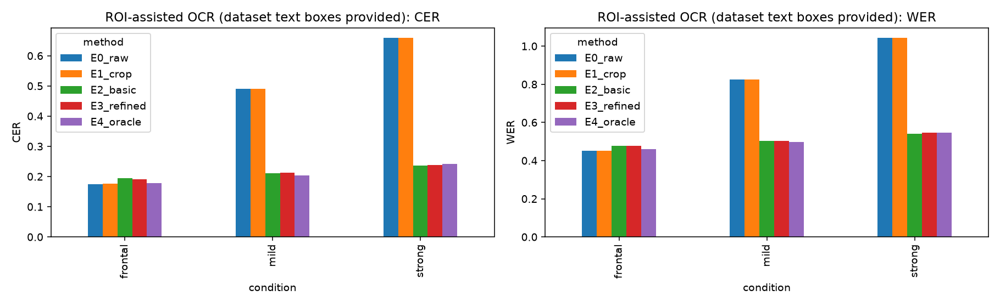
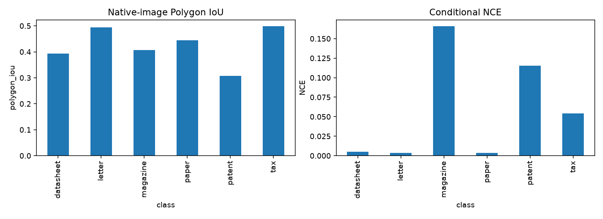

# Intelligent Document Detection and Perspective Correction for OCR Enhancement

## Problem and Scope

Detect one approximately planar printed page, estimate four corners, and rectify perspective for fixed-engine English OCR. Real-photo geometry and controlled scan OCR address separate research questions. This study tests a classical contour baseline and robust boundary-line refinement.

## Theory

A homography maps planar points by s[u,v,1]^T = H[x,y,1]^T. Four noncollinear corner correspondences determine eight degrees of freedom up to scale. OpenCV solves the four-point transform; there are no redundant correspondences for RANSAC to reject a wrong corner. Axis-aligned cropping cannot remove converging page edges.

Native-image Polygon IoU equals intersection area divided by union area. NCE is mean Euclidean error across the four semantic vertices divided by the diagonal of the GT axis-aligned bounding box. CER and WER equal (substitutions + deletions + insertions) divided by GT character count and whitespace-token count, respectively.

## Dataset

SmartDoc Challenge 1 is a real smartphone/tablet geometry dataset, licensed CC BY 4.0 (Burie et al., 2015). The prepared source contains 24,889 metadata rows; the manifest selects 600 frames: 360 development, 120 validation and 120 test, with document identities disjoint. This project reports native-image polygon IoU, not the official document-frame score, and makes no SmartDoc transcription claim.

FUNSD (Jaume, Ekenel and Thiran, 2019) contains 199 annotated scanned forms. Its official 149/50 train/test split is retained; training is subdivided into 119 development and 30 validation pages using seed 42. The user personally accepted its noncommercial research/education and age terms. Derived views remain private local artifacts. Published entity annotations can contain noise.

## Method

EXIF-aware BGR input is resized to a 1400-pixel longest side with explicit x/y transforms. Gaussian 5x5 blur precedes Canny 50/150 and 3x3 closing. Only after no valid candidate, a fixed threshold grid 25/75 then 10/40 is attempted. External contours precede an all-contour fallback. Convex four-vertex candidates are scored by normalized area, edge support, convexity and border penalty. Polygon masks and numerical candidate scores are saved.

The baseline uses approxPolyDP in a fixed epsilon order. Cyclic convex ordering selects an upright top edge without consulting GT. The proposed method collects normal-compatible Canny pixels in narrow edge corridors, fits Huber lines, removes gross outliers, refits, and intersects adjacent lines. Unsupported or unstable refinements retain the baseline with a rejection diagnostic. Corners are mapped back to full resolution before warping. SmartDoc model dimensions supply only a physical ratio prior. FUNSD E2-E4 preserve the scan size.

## Experimental Protocol

All runs use CPU and seed 42. Only validation data informed configuration selection; final test inference uses a frozen YAML. Controlled views use a neutral-gray canvas 1.6 times the scan dimensions. Per-coordinate displacements are 3-10% for mild and 10-22% for strong; nonconvex, off-canvas and too-small polygons are rejected. The exact H, polygon, size, source identity, seed and selected masks are logged. Views are not smartphone photographs.

E0 uses the raw view; E1 uses the detected axis-aligned crop; E2 uses baseline rectification; E3 uses refined rectification; E4 uses known synthesis corners only as an oracle. Primary ROI-assisted OCR uses provided entity boxes composed through each branch transform and axis-aligned crops without a second local warp. E1 can coincide with E0 under this region-assisted protocol. Fixed Tesseract language is eng, page PSM 3, ROI PSM 6, with identical 5%-height/minimum-2-pixel padding and no ROI scaling. NFKC, casefold and whitespace collapse preserve punctuation and digits. WER uses whitespace tokens. CER/WER pool edit totals over reference lengths. Failed predictions are empty strings; conditional-success summaries are separate. Views are paired by source document; no significance test is claimed.

## Results

| Method | Split | Samples | Valid | IoU (all) | NCE (valid) | Runtime ms |
| --- | --- | --- | --- | --- | --- | --- |
| baseline | test | 120 | 55 | 0.423271 | 0.057760 | 71.862613 |
| refined | test | 120 | 55 | 0.423889 | 0.057602 | 111.071496 |

IoU (all) includes failures as zero. NCE uses the GT bounding-box diagonal and is conditional on valid predictions. Validity indicates geometric output availability, not semantic correctness.

OCR run covers 50 source documents and 3 conditions on split test. Primary metric: ROI-assisted OCR (dataset text boxes provided).

| Condition | Method | Entities | Failures | CER | WER |
| --- | --- | --- | --- | --- | --- |
| frontal | E0_raw | 2270 | 0 | 0.174574 | 0.452629 |
| frontal | E1_crop | 2270 | 0 | 0.176929 | 0.452400 |
| frontal | E2_basic | 2270 | 0 | 0.194129 | 0.478634 |
| frontal | E3_refined | 2270 | 0 | 0.190507 | 0.477260 |
| frontal | E4_oracle | 2270 | 0 | 0.179146 | 0.459732 |
| mild | E0_raw | 2270 | 0 | 0.489757 | 0.826097 |
| mild | E1_crop | 2270 | 0 | 0.489737 | 0.826097 |
| mild | E2_basic | 2270 | 0 | 0.210815 | 0.502234 |
| mild | E3_refined | 2270 | 0 | 0.212181 | 0.502234 |
| mild | E4_oracle | 2270 | 0 | 0.203294 | 0.498912 |
| strong | E0_raw | 2270 | 0 | 0.659323 | 1.043418 |
| strong | E1_crop | 2270 | 0 | 0.659323 | 1.043418 |
| strong | E2_basic | 2270 | 0 | 0.236011 | 0.540955 |
| strong | E3_refined | 2270 | 0 | 0.238862 | 0.545538 |
| strong | E4_oracle | 2270 | 0 | 0.242167 | 0.546340 |

Paired complete-sample comparison against raw recognition:

| Condition | Method | Docs | Delta CER | Better | Same | Worse |
| --- | --- | --- | --- | --- | --- | --- |
| frontal | E1_crop | 50 | 0.002355 | 16 | 19 | 15 |
| frontal | E2_basic | 50 | 0.019555 | 11 | 2 | 37 |
| frontal | E3_refined | 50 | 0.015933 | 15 | 1 | 34 |
| frontal | E4_oracle | 50 | 0.004572 | 19 | 4 | 27 |
| mild | E1_crop | 50 | -0.000020 | 1 | 49 | 0 |
| mild | E2_basic | 50 | -0.278942 | 47 | 0 | 3 |
| mild | E3_refined | 50 | -0.277577 | 45 | 1 | 4 |
| mild | E4_oracle | 50 | -0.286464 | 47 | 0 | 3 |
| strong | E1_crop | 50 | 0.000000 | 0 | 50 | 0 |
| strong | E2_basic | 50 | -0.423312 | 50 | 0 | 0 |
| strong | E3_refined | 50 | -0.420462 | 50 | 0 | 0 |
| strong | E4_oracle | 50 | -0.417157 | 50 | 0 | 0 |

## Discussion

Both geometric methods produced 55/120 valid outputs. Mean complete-sample IoU changed from 0.423271 to 0.423889; conditional median NCE changed from 0.004222 to 0.003536. Conditional p90 NCE changed from 0.010762 to 0.012264. The refinement did not recover missed detections. For frontal views, pooled ROI-assisted CER changed from 0.174574 to 0.190507. For mild views, pooled ROI-assisted CER changed from 0.489757 to 0.212181. For strong views, pooled ROI-assisted CER changed from 0.659323 to 0.238862. Repeated resampling is one plausible reason a frontal oracle can worsen recognition; the oracle is a geometric reference, not a guaranteed recognition upper bound. Observed runtimes reflect this host's workload, rather than an isolated hardware comparison.

Compare the reported conditional geometry values with complete-sample IoU before attributing an effect to refinement. A valid quadrilateral can select the wrong object or semantic orientation. The paired OCR table reports whether E3 improves or worsens recognition for each source page; improvements are not assumed. The oracle measures known-transform correction and is excluded from automatic-system success rates. Raw page OCR and heuristic reading-order scores are exploratory artifacts only.

## Limitations

The model assumes a single planar roughly upright page. Shadows, clutter, weak/broken edges, occlusion and low contrast can defeat contour extraction; content edges can bias line fits. The boundary cannot identify 180-degree semantic orientation. Interpolation and original scan quality limit recoverable text; inaccurate rectification can reduce recognition quality. Known ROI boxes assist localization, so these scores are not end-to-end automated text detection. Controlled scan views do not establish real-camera OCR gains. Multiple views of a document are dependent. Colab/Kaggle execution requires separate hosted verification.

## Conclusion

The implementation provides independently tested preprocessing, contour detection, validated corner refinement, projective warping and auditable CPU OCR experiments. The measured tables define the evidence; they do not imply guaranteed accuracy gains. Detection coverage remains a material limitation to address on development data in a future experiment with a fresh final evaluation protocol.

## Reproducibility

Python 3.12.10; OpenCV 4.11.0.86; Tesseract 5.4.0.20240606; 16 logical CPUs. Measured stage runtimes, frozen configs, source hashes, manifests and failures are stored in each run. No GPU, training or proprietary OCR API is used.

- [20261119T172246433110Z_geometry_baseline_test](../results/20261119T172246433110Z_geometry_baseline_test/report.md)
- [20261119T172258558113Z_geometry_refined_test](../results/20261119T172258558113Z_geometry_refined_test/report.md)
- [20261119T172316407276Z_ocr_test](../results/20261119T172316407276Z_ocr_test/report.md)

## References

- Burie et al. ICDAR2015 Competition on Smartphone Document Capture and OCR (SmartDoc), 2015. [Source and CC BY 4.0 attribution](https://github.com/jchazalon/smartdoc15-ch1-dataset).
- Jaume, Ekenel and Thiran. FUNSD: A Dataset for Form Understanding in Noisy Scanned Documents, 2019. [Dataset](https://guillaumejaume.github.io/FUNSD/).
- Canny. A Computational Approach to Edge Detection, IEEE TPAMI, 1986.
- [OpenCV shape analysis and transforms](https://docs.opencv.org/4.x/).
- [Tesseract OCR documentation](https://tesseract-ocr.github.io/tessdoc/).

## Team Contributions

Team names, student IDs and actual contribution/commit evidence are to be supplied by the team. Codex assisted implementation and local verification. No human contributions or official submission filename have been invented.

Aggregate-only artifacts and run/source hashes: [run index](artifacts/run_index.json).
